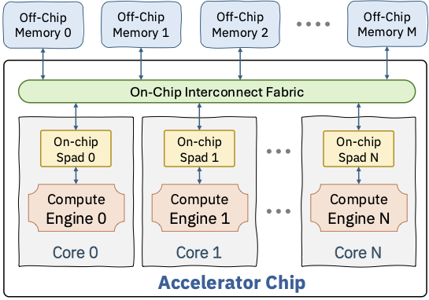

# **SuperDSC-Bundle Interface Specification**

**Spec Version:** 1.0.0
**Status:** Active

> The spec version follows the deeptoolsRelease versioning.

**Authors:**
* @lupalby
* @Prasanth-Chatarasi
* @bmahjour
* @viji560
* @vswagath1989
* @jneves60

## **Summary**

This document is the entry point for the `SuperDSC-Bundle` interface specification — the contract between the **torch-spyre** frontend compiler and the **Deeptools** backend compiler. A SuperDSC-Bundle consists of one `bundle.mlir` file and one or more `sdsc_*.json` files. Together they describe everything the Spyre hardware needs to compile and execute a complex kernel.

For the complete API reference see the [Spec Map](#spec-map) at the end of this document.

## Scope

This specification defines the binary interface between the **torch-spyre** frontend compiler and the **Deeptools** backend compiler via the SuperDSC-Bundle artifact. It covers:

- The schema and semantic rules for `sdsc_*.json` files
- The `sdscbundle` MLIR dialect used in `bundle.mlir`
- All operations expressible on the Spyre hardware at the data-parallel abstraction level
- Conformance rules for both file types

It does **not** cover:

- The internal implementation of torch-spyre or Deeptools
- The `SpyreCode` format produced by the backend
- The future KTIR interface (see [Normative References](#normative-references))

**Audience:** engineers writing or consuming a SuperDSC-Bundle — either implementing a frontend compiler that emits the bundle or a backend compiler that ingests it.

**Conformance:** A bundle is conformant when every `sdsc_*.json` file validates against [`sdscbundle-schema.json`](spec/sdscbundle-schema.json) and every semantic rule stated in the individual object pages is satisfied. The key words "MUST", "MUST NOT", "REQUIRED", "SHALL", "SHALL NOT", "SHOULD", "SHOULD NOT", "RECOMMENDED", "NOT RECOMMENDED", "MAY", and "OPTIONAL" in this specification and its sub-documents are to be interpreted as described in BCP 14 [RFC2119] [RFC8174] when, and only when, they appear in all capitals.

## Normative References

| Reference | Role |
|-----------|------|
| [RFC 2119 / RFC 8174](https://www.rfc-editor.org/rfc/rfc8174) | Key words for use in RFCs to Indicate Requirement Levels (BCP 14) |
| [`sdscbundle-schema.json`](spec/sdscbundle-schema.json) | Machine-readable structural contract. Validates required fields, enum values, and type constraints for all `sdsc_*.json` files. Written against **JSON Schema draft 2020-12**. |
| [MLIR SCF Dialect](https://mlir.llvm.org/docs/Dialects/SCFDialect/) | `scf.for` used in bundle loops |
| [MLIR Affine Dialect](https://mlir.llvm.org/docs/Dialects/Affine/) | `affine.apply` used for address computation |
| [MLIR Arith Dialect](https://mlir.llvm.org/docs/Dialects/ArithDialect/) | `arith.constant`, `arith.addi` used in bundles |
| [torch-spyre](https://torch-spyre.readthedocs.io/) | Upstream frontend compiler; defines supported PyTorch ops |

**Informative references** (not normative):

| Reference | Purpose |
|-----------|---------|
| [KTIR RFC](https://github.com/torch-spyre/rfcs/blob/main/0682-KtirSpec/0682-KtirSpecRFC.md) | Future replacement interface for SuperDSC-Bundle |
| [Deeptools paper](https://research.ibm.com/publications/deeptools-compiler-and-execution-runtime-extensions-for-rapid-ai-accelerator) | Background on the backend compiler |

## Terms and Definitions

| Term | Definition |
|------|------------|
| **SuperDSC** | *Super Design Space Configuration.* A JSON-based IR that describes the tile-level compute graph for all cores of a Spyre device for a single scheduled torch operation. |
| **SuperDSC-Bundle** | A set of files — one `bundle.mlir` and one or more `sdsc_*.json` files — that collectively describe a complex kernel to be compiled and executed on Spyre. |
| **DSC (DesignSpaceConfig)** | One entry in the `dscs_[]` array of a SuperDSC object. Holds the tensor descriptors, schedule tree, data staging, and compute operation for one compute configuration. |
| **core** | A single processing unit on Spyre, comprising one compute engine (AIU) and one scratchpad memory (LX). Spyre currently has 32 cores. |
| **corelet** | A sub-unit within a core. Each core contains two corelets. Frontend-emitted bundles (torch-spyre) set `coreletFoldProp_.factor_` to `1` and leave corelet splitting to DeepTools. |
| **fold / folding** | A mechanism by which a single parameterised JSON artifact represents the behaviour of all cores compactly. Fold properties encode affine transformations (`α × index + β`) that compute per-core coordinates and addresses without duplicating the descriptor for each core. See [FoldProperty](spec/json/foldproperty.md) and [FoldManager](spec/json/foldmanager.md). |
| **work division** | The assignment of portions of the operation's iteration space to individual cores, expressed via `numWkSlicesPerDim_`, `coreIdToWkSlice_`, and `coreFoldProp_`. |
| **stick** | The innermost contiguous unit of tensor storage on Spyre. Each tensor dimension is either a *stick dimension* (innermost, packed) or a *non-stick dimension* (outer). The stick size and composition are constrained per operation category. See [Stick Layout Constraints](spec/json/stick-layout-constraints.md). |
| **data staging** | The process of transferring tile-sized slices of tensor data into LX scratchpad before compute. Described by `DataStageParam` entries (`ss_` for steady-state tiles, `el_` for the epilogue tile). |
| **symbolic value** | A dimension size or tensor start address that is not known at compile time and is resolved just before the job is launched on Spyre. Represented by a symbol ID string; bound via `sdscbundle.sdsc_execute`'s `symbol_ids` operand. |
| **SpyreCode** | The compiled output produced by Deeptools from a SuperDSC-Bundle. Contains the job binary, job plan, and any program-correction tables needed to resolve symbolic values at launch. |

## Execution Model

A user-written PyTorch program is compiled by torch-spyre to generate a set of files known as the **SuperDSC-Bundle**. A PyTorch file may translate into several SuperDSC-Bundles, each one composed of a `bundle.mlir` file and several `sdsc_*.json` files. Each SuperDSC-Bundle is compiled by Deeptools to generate the assembly code and execution plan that runs on the Spyre AI Accelerator Card.

<p align="center">
  
</p>
<p align="center">
  Figure 1. High-level view of SuperDSC-Bundle API within the torch-spyre stack
</p>

`SuperDSC-Bundle` views the Spyre hardware at the data-parallel level of abstraction: multiple cores, each with a compute engine (AIU) and scratchpad memory (LX), connected to each other and to off-chip memory (HBM/DDR) via an on-chip interconnect fabric.

<p align="center">
  
</p>
<p align="center">
  Figure 2. Hardware abstraction of multi-core accelerator embodied in `SuperDSC-Bundle`
</p>

The SuperDSC-Bundle output is consumed by the Deeptools backend compiler to produce `SpyreCode`. `SpyreCode` contains the job binary, a job plan, and other compiled artifacts. When start addresses and/or dimension sizes are symbolic, `SpyreCode` carries program-correction tables — variables embedded in the program binary that are substituted or corrected just-in-time before the job is launched on Spyre. The backend compiler produces this correction mechanism as part of `SpyreCode`.

> **Notes**
> - The Frontend/Backend compiler interface will transition to a new interface called Kernel Tile Intermediate Representation (KTIR) in the future (https://github.com/torch-spyre/rfcs/blob/main/0682-KtirSpec/0682-KtirSpecRFC.md)
> - `SuperDSC` (without bundle capability) is the current interface between torch-spyre frontend compiler and Deeptools backend compiler
> - `SpyreCode` is tracked through: https://github.com/torch-spyre/torch-spyre/issues/277

## Structure of SuperDSC-Bundle

A SuperDSC-Bundle contains:

- One or more `sdsc_*.json` files, each describing a single Spyre operation
- One `bundle.mlir` file with the SuperDSC-Bundle IR

### API Components

The API consists of two primary components:

1. **MLIR Bundle File** (`.mlir`) — Orchestrates execution flow, symbol management, and operation sequencing across one or more SDSC JSON files. See [MLIR Bundle API](spec/dialect/MLIR-bundle-API.md) for the full dialect reference.
2. **SDSC JSON Files** (`.json`) — Each file defines a single operation and its core mapping. See [SDSC JSON API](spec/json/SDSC-json-api.md) for the structural guide, object hierarchy, producer conventions, and complete JSON object reference index.

> **Note:** `DesignSpaceConfig` can represent both deep learning operators (matmul, convolution, activations, reductions) and data-shuffle operations (stick-breaking, gather, scatter). Tensor allocation need not be compatible with compute work division — the backend compiler ensures proper data movement across cores.

### SuperDSC-Bundle MLIR Representation

The `bundle.mlir` file conveys a complex kernel made of one or multiple operations. It chains together multiple SDSC operations in sequence and can add loops around them using new and existing MLIR operations. For the complete dialect reference with all syntax tables and examples see [MLIR Bundle API](spec/dialect/MLIR-bundle-API.md).

#### Bundle Container

A SuperDSC Bundle is expressed as a standard MLIR `module` containing a single `func.func`. The function declares the bundle entry point: it has no return values and its body ends with `return`. It MAY declare zero or more parameters — each is either a compile-time `index` value or a runtime-provided `!sdscbundle.input_arg<index>` value (which MUST be extracted with `sdscbundle.input_arg_extract` before use).

```mlir
module {
  func.func @sdsc_bundle(%param_0: index,
                         %param_1: !sdscbundle.input_arg<index>) {
    // Bundle operations
    return
  }
}
```

Each parameter is one of:

| Type | Description |
|---|---|
| *(none)* | No parameters — all symbol values are embedded as `arith.constant` values inside the function body. |
| `index` | A resolved symbol value passed directly as a constant index. |
| `!sdscbundle.input_arg<index>` | A runtime-provided symbol value. MAY carry `granularity=N` and/or `max_value=N` annotations. MUST be extracted with `sdscbundle.input_arg_extract` before use. |

#### Symbolic Values and Addresses

Within a SuperDSC Bundle there are two distinct ways a value can be symbolic — not fixed at compile time and resolved by the backend just before the job is launched.

**Symbolic Addresses** — a tensor's start address in device memory is not a concrete byte offset at compile time. On the JSON side: set `isStartAddrSymbolic_: true` on the `allocate` node in `scheduleTree_` and place symbolic identifier strings in `startAddressCoreCorelet_.data_`. On the MLIR side: supply the runtime value as an operand to `sdscbundle.sdsc_execute` via `symbol_ids`.

**Symbolic Dimension Sizes** — a tensor shape dimension (e.g. sequence length or batch size) varies at runtime. On the JSON side: `DesignSpaceConfig.dimToSymbolMapping_` maps dimension names to symbolic variable names; `DataStructDims.symbolicDimInfo_` records `maxSize_` and `granularity_` for each symbolic dimension; `SuperDsc.symbolDefinitions_`, `inputSymbolsAndTags_`, and `dimToSymbolMappingOpcodeCorrection_` hold the top-level symbol registry. On the MLIR side: the runtime value is also supplied as an operand to `sdscbundle.sdsc_execute` via `symbol_ids` — the same mechanism as symbolic addresses.

From the MLIR perspective both kinds of symbolic value are unified: they are operands to `sdscbundle.sdsc_execute` bound via `symbol_ids`. The distinction is on the JSON side — the backend routes each symbol ID to the appropriate field depending on whether it is bound to an `isStartAddrSymbolic_` allocate node (address) or to a `dimToSymbolMapping_` entry (size). When a symbolic dimension is split across cores, both kinds appear together in the same JSON file.

#### `sdscbundle` Dialect Operations and Supporting MLIR Operations

For the complete reference — `sdscbundle.sdsc_execute`, `sdscbundle.device_mem_allocate`, `sdscbundle.input_arg_extract`, `scf.for`, `arith.constant`, `arith.addi`, and `affine.apply` — with full syntax tables, constraints, and examples, see [MLIR Bundle API](spec/dialect/MLIR-bundle-API.md).

### `sdsc_*.json` Structure and Object Reference

Each `sdsc_*.json` file describes a single torch operation. For the overall structural specification, object hierarchy, producer conventions, and complete index to all object reference documents, see [SDSC JSON API](spec/json/SDSC-json-api.md). For a step-by-step procedural walkthrough, see [Filling a JSON File — Step-by-Step](guide/Overview.md#filling-a-json-file--step-by-step) in the Overview guide.

### Supported OpFuncs in `sdsc.json`

For the full list of supported `opFuncName` values, see [ComputeOperation — Supported Operations](spec/json/computeoperation.md#supported-operations).

### Stick Constraints for the Operations

Each operation category imposes constraints on stick composition, restricting which dimensions can be present in the stick. Tensors MUST be padded to meet these constraints. There are no constraints on tensor layout beyond the stick.

**Important:** Stick constraints can cause a ripple effect — a tensor MUST be padded even in its non-stick dimension if that dimension appears in the stick of another tensor feeding the same operation. This ensures dimension span consistency across all tensors.

For per-category stick layouts and padding rules see [Stick Layout Constraints](spec/json/stick-layout-constraints.md).

### Core Work Division Constraints

For per-core work extent rules (stick-multiple alignment, DDR address span, index tensors, and multi-dimension reduction splits) see [Stick Layout Constraints — Core Work Division](spec/json/stick-layout-constraints.md#core-work-division-constraints).

---

## Spec Map

Quick reference to every document in this specification, grouped by role.

### MLIR Dialect — `sdscbundle`

| Document | Description |
|----------|-------------|
| [MLIR Bundle API](spec/dialect/MLIR-bundle-API.md) | Dialect operations, bundle container, symbolic values |

### JSON Layer & Object Reference

| Document | Description |
|----------|-------------|
| [SDSC JSON API](spec/json/SDSC-json-api.md) | Structural filling guide, object hierarchy tree, producer conventions, and complete JSON object reference index |
| [JSON Schema (normative)](spec/sdscbundle-schema.json) | Machine-readable JSON Schema (draft 2020-12) |

> **Note:** For individual specifications of every JSON object, allocation node, tensor descriptor, constant encoding, compute operation, and layout constraint, see the complete [JSON Object Reference Index](spec/json/SDSC-json-api.md#json-object-reference-index) in the SDSC JSON API document.

### Guides & Examples (non-normative)

See the [Overview Guide](guide/Overview.md), which introduces the Spyre stack and the step-by-step filling walkthrough, and links to all MLIR and JSON examples in `guide/`.

### References

| Document | Description |
|----------|-------------|
| [References](spec/reference.md) | External specs and normative references |
