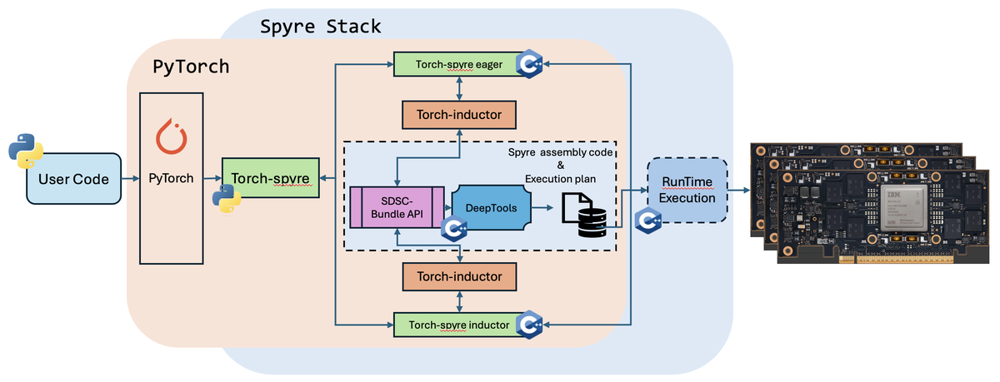

# Overview

The SuperDSC-Bundle API defines the interface between [torch-spyre](https://torch-spyre.readthedocs.io/) frontend compiler to PyTorch and the Spyre backend compiler ([Deeptools](https://research.ibm.com/publications/deeptools-compiler-and-execution-runtime-extensions-for-rapid-ai-accelerator)) that generates the code to run on the [IBM Spyre AI Accelerator](https://research.ibm.com/blog/lifting-the-cover-on-the-ibm-spyre-accelerator). 

SuperDSC stands for ***Super Design Space Configuration*** and is a JSON-based IR designed to describe the tile-level compute graph for the 32 cores of Spyre.
A SuperDSC-Bundle enables the expression of data-parallel mappings for complex kernels across multi-core accelerators.
Follow the link for a description of the [SuperDSC-Bundle Interface Specification](../SuperDSC-Bundle.md).

The figure below illustrates what is called the Spyre Stack where a user-written PyTorch program is compiled by torch-spyre to generate a set of files known as the **SuperDSC-Bundle**. A PyTorch file may translate into several SuperDSC-Bundles, each one being composed of a ***bundle.mlir*** file and several ***sdsc_\*.json*** files, each JSON file describing a torch operation (a full list of supported PyTorch operations can be found in [torch-spyre](https://torch-spyre.readthedocs.io/)).
Each SuperDSC-Bundle is compiled by **DeepTools** to generate the assembly code that runs on the Spyre AI Accelerator Card. Furthermore, the compiler also generates the execution plan that manages the execution of an operation as well as intra-memory data movement on the Spyre Card.

*Figure 1: High-Level View of SuperDSC-Bundle API within torch-spyre stack*

SuperDSC is a self-contained compiled artifact that describes everything the Spyre hardware needs to execute a single scheduled operation deterministically. The top-level structure contains core fold properties, work-slice mappings, and a per-core execution schedule. A `dscs_` array holds one or more DesignSpaceConfig entries. Each entry is a complete description of one compute configuration, and contains the following elements.

- **Core fold properties** (`coreFoldProp_`, `numWkSlicesPerDim_`, `coreIdToWkSlice_`): how to divide the iteration space across cores. Any operation can use up to 32 cores — the current core count on Spyre, though this limit may increase in future hardware generations. For a tensor of shape (1024, 256), this encodes how many rows each core processes. The encoding gives each core an equal number of sticks and keeps each core within its addressable device memory limit.
- **Tensor descriptors** (`labeledDs_`, `primaryDsInfo_`): for each tensor argument, the tiling structure defines which dimensions are stick dimensions, how the host-side shape maps to device-side tiles, memory residency (HBM vs. LX scratchpad), data format, and which dimensions each tensor iterates over fully vs. which are summed over (contracted) as in the K dimension of a matmul.
- **Schedule tree** (`scheduleTree_`): a list of allocate nodes (one per tensor) that specify memory placement (HBM or LX scratchpad), dimension ordering, per-core start addresses via fold mappings, and coordinate information encoding how each dimension is split across cores with affine transformations.
- **Data staging** (`dataStageParam_`): per-core dimension sizes for steady-state and epilogue passes, describing how data is partitioned for transfer into scratchpad.
- **Compute operations** (`computeOp_`): one entry per operation, encoding the execution unit (PT or SFP), operation name, data format, fidelity, and the input/output tensor references from labeledDs_.

Folding is a central concept in SuperDSC. A single parameterized artifact can represent multiple execution variants across time steps and cores without recompilation. Fold properties use affine transformations (alpha * index + beta) to compute per-core coordinates and addresses. One JSON file describes the behavior of all active cores compactly instead of duplicating the description for each core.

## Hardware Abstraction Model

SuperDSC-Bundle views Spyre hardware at the **data-parallel level of hardware abstraction**:

- **Multiple cores**, each with:
  - Compute engine (AIU)
  - Scratchpad memory (LX)
- **On-chip interconnect fabric** connecting cores and off-chip memory banks
- **Off-chip memory** (HBM/DDR) for large data storage

*Figure 2: Hardware abstraction of multi-core accelerator embodied in **SuperDSC-Bundle***

This abstraction enables frontend compilers to express:

- Complex kernels comprised of operation sequences
- Work division (computation split) across Spyre cores
- Tensor placement in DDR memory or LX scratchpad
- Static or symbolic shapes and start addresses

The SuperDSC-Bundle output is consumed by Deeptools to produce `SpyreCode`. For a full description of `SpyreCode` and its symbolic correction mechanism, see [Execution Model](../SuperDSC-Bundle.md#execution-model).

## API Components

The API consists of two primary components:

1. **MLIR Bundle File** (`.mlir`) — Orchestrates execution flow and symbol management
2. **SDSC JSON Files** (`.json`) — Defines individual operations and their core mappings

All `sdsc_*.json` files conform to the [SDSC Bundle JSON Schema](/0248-SdscBundleSpec/spec/sdscbundle-schema.json).
The schema provides machine-readable type constraints, required-field enforcement, and enum
validation for every object in the hierarchy. It is the normative reference for structural
correctness.

## Important Notes

For supported operation categories (including data-shuffle operations such as stick-breaking, gather, and scatter) and tensor allocation rules, see the [API Components note](../SuperDSC-Bundle.md#api-components) in the spec, [ComputeOperation](/0248-SdscBundleSpec/spec/json/computeoperation.md), and [Stick Layout Constraints](/0248-SdscBundleSpec/spec/json/stick-layout-constraints.md).

---

## Filling a JSON File — Step-by-Step

This section walks through filling an SDSC JSON file in the same order as the
[`SuperDsc` object hierarchy](/0248-SdscBundleSpec/spec/json/SDSC-json-api.md#structural-hierarchy-tree): SuperDSC top-level container
first, then the per-operation `DesignSpaceConfig` fields in the order they
appear in the schema, finishing with the deepest leaf objects.

| Step | Object / Field | Hierarchy level |
|---|---|---|
| 1 | Root key · `SuperDsc`: `coreFoldProp_`, `coreletFoldProp_`, `numCoresUsed_` | Root → SuperDSC |
| 2 | `SuperDsc`: `numWkSlicesPerDim_`, `coreIdToWkSlice_`, `coreIdToDsc_`, `coreIdToDscSchedule` | SuperDSC |
| 3 | `dscs_` entry · `DesignSpaceConfig`: `numCoresUsed_`, `coreIdsUsed_` | SuperDSC → DSC |
| 4 | `DesignSpaceConfig`: `N_`, `dataStageParam_` | DSC |
| 5 | `DesignSpaceConfig`: `primaryDsInfo_` | DSC |
| 6 | `DesignSpaceConfig`: `scheduleTree_` → `ScheduleTreeNode` → `coordinates_` → `CoordinateInfo` | DSC (deepest branch) |
| 7 | `DesignSpaceConfig`: `labeledDs_` → `LabeledDataStructure` → `memOrg_` | DSC |
| 8 | `DesignSpaceConfig`: `constantInfo_` → `ConstantInfo` | DSC |
| 9 | `DesignSpaceConfig`: `computeOp_` → `ComputeOperation` | DSC (last leaf) |

### Step 1 — Root key and SuperDSC fold properties

Create the root object with a single key — the operation name string
(pattern `^[a-zA-Z0-9_/\-][a-zA-Z0-9_/\-]*$`). Its value is the
[`SuperDsc`](/0248-SdscBundleSpec/spec/json/superdsc-object.md) object. Fill the fold properties first, as
every [`FoldManager`](/0248-SdscBundleSpec/spec/json/foldmanager.md) used later inherits from these:

- Set `coreFoldProp_.factor_` to a value between 1 and the maximum number of cores
  in use (e.g. `32` for a full-chip bundle, or `2` for a 2-core bundle). Set `label_` to `"core"`.
- Set `coreletFoldProp_.factor_` to `1`; corelet splitting is left to DeepTools. Set `label_` to `"corelet"`.
- Set `numCoresUsed_` to the total number of cores.
- (Optional) Set `sdscFoldProps_` and `sdscFolds_` only when bundle-level fold
  dimensions above the core level are required.

### Step 2 — SuperDSC work-division maps

Still in [`SuperDsc`](/0248-SdscBundleSpec/spec/json/superdsc-object.md), fill the maps that assign work
slices and DSC indices to cores:

- Set `numWkSlicesPerDim_`: for each dimension being split across cores, record
  the total number of slices (e.g. `{"mb": 2}` for a 2-way minibatch split).
- Set `coreIdToWkSlice_`: for each core ID, map each split dimension to the
  slice index that core handles (e.g. `{"0": {"mb": 0}, "1": {"mb": 1}}`).
- Set `coreIdToDsc_`: map each core ID (as a string integer) to its zero-based
  index into `dscs_`. All cores typically map to `0` when work is balanced.
- Set `coreIdToDscSchedule`: for each core, one schedule tuple `[-1, 0, 0, 0]`
  covers the common case (single DSC, no data-op DSC, no barriers). The four integers are
  `[datadsc_idx, dldsc_idx, before_sync, after_sync]`:
  - `datadsc_idx` = `-1` (no data-op DSC is attached)
  - `dldsc_idx` = `0` (zero-based index into `dscs_` for the executed `DesignSpaceConfig`)
  - `before_sync` = `0` (no barrier before step)
  - `after_sync` = `0` (no barrier after step)
- (Optional) Populate `inputSymbolsAndTags_` when symbolic dimensions are
  used.

### Step 3 — DesignSpaceConfig identity (inside dscs_)

Add one entry to `dscs_` — a single-key object `{"<op_name>": <DesignSpaceConfig>}`.
Inside the [`DesignSpaceConfig`](/0248-SdscBundleSpec/spec/json/designspaceconfig.md), set the core identity
fields first, as they are referenced by the data-staging and tensor steps below:

- Set `numCoresUsed_` and `coreIdsUsed_` to match the cores assigned to this
  DSC via `coreIdToDsc_` in Step 2.

### Step 4 — Total operation dimensions (N_) and data staging (dataStageParam_)

In [`DesignSpaceConfig.N_`](/0248-SdscBundleSpec/spec/json/datastructdims.md):

- Set each dimension field that participates in the operation to its total
  (un-tiled) size. Set all others to `-1`.
- For symbolic dimensions, set the field to `-1` (sentinel) and populate
  `dimToSymbolMapping_` to link each symbolic dimension name to its symbol ID.

In [`DesignSpaceConfig.dataStageParam_`](/0248-SdscBundleSpec/spec/json/datastageparam.md):

- Add exactly one entry with key `"0"`. Optionally set `name_` to `"core"` — the schema does not require it, but it is conventional for all compute operations. Valid values are `"core"`, `"corelet"`, or `"row"`; `"core"` is the conventional choice for compute operations.
- Set `ss_` and `el_` to the per-core tile sizes. When work divides evenly
  `ss_` and `el_` are identical; `el_` carries the smaller final tile
  when it does not.
- For window/padded operations (avgpool2d, maxpool2d, conv2d, depthwise conv2d): add `paddingSizes_`
  to both `ss_` and `el_`. If a padded dimension is split across cores, set
  `padFront_` and `padBack_` to `-1` in the per-core data staging entry.
  See [Padding](/0248-SdscBundleSpec/spec/json/padding.md) for the full field set.
- For symbolic dimensions: add `symbolicDimInfo_` inside each
  [`DataStructDims`](/0248-SdscBundleSpec/spec/json/datastructdims.md). Set `maxSize_` to the upper bound and
  `granularity_` to the step constraint. When the dimension is split across N
  cores, make `granularity_` a multiple of N and scale the `ss_`/`el_` values
  to the per-core size.

### Step 5 — Tensor layout (primaryDsInfo_)

In [`DesignSpaceConfig.primaryDsInfo_`](/0248-SdscBundleSpec/spec/json/primarydsinfo.md), add one entry for
each distinct tensor role. Multiple tensors that share the same stick layout
can share one entry:

- Key each entry by `dsType_` (`"INPUT"`, `"OUTPUT"`, `"KERNEL"`,
  `"KERNEL_IDX"`).
- Set `layoutDimOrder_` (outermost dimension first).
- Set `stickDimOrder_` and `stickSize_` as parallel arrays. Consult
  [Stick Layout Constraints](/0248-SdscBundleSpec/spec/json/stick-layout-constraints.md) for the exact
  stick rules for each operation category.

### Step 6 — Memory allocation schedule (scheduleTree_)

In [`DesignSpaceConfig.scheduleTree_`](/0248-SdscBundleSpec/spec/json/scheduletreenode.md), add one
[`ScheduleTreeNode`](/0248-SdscBundleSpec/spec/json/scheduletreenode.md) per tensor, in the order tensors
will be allocated:

- Set `nodeType_: "allocate"`, a unique `name_`, and `ldsIdx_` matching the
  tensor's sequential position in `labeledDs_` (filled in Step 7).
- Set `component_` to `"hbm"` or `"lx"`.
- Set `layoutDimOrder_` and `maxDimSizes_` (use `-1` for unbound dimensions;
  use the page size for paged value tensors).
- Set `startAddressCoreCorelet_` as a [`FoldManager`](/0248-SdscBundleSpec/spec/json/foldmanager.md):
  - First fold dimension: `Map` function — each core ID maps to its own start
    address in `data_`.
  - Second fold dimension: `Const` function — all corelets on a core share the
    same base address.
  - When the address is not known at compile time, set
    `isStartAddrSymbolic_: true` and use the symbol ID string (e.g. `"-1"`) as
    the `data_` value in place of a concrete byte offset.
- For back-gaps: populate `backGapCore_` with the gap size in elements, keyed
  by dimension then by core ID. Use `"-1"` as the core ID key for HBM
  allocations; use the actual core ID for LX allocations. Only back-gaps are
  encoded here — front gaps are handled by advancing the start address.
- For indirect access (paged tensors): set `indirectAllocType_` to
  `"value_tensor"` or `"index_tensor"`, set `relatedIndirectAccessAlloc_` to
  the name of the counterpart node, and set `indexTensorType_` (`"index"` or
  `"address"`) on the index tensor's node. For direct (non-indirect) tensors
  the field can be omitted or set to `"no_indirection"`.
- Set `coordinates_` (a [`CoordinateContainer`](/0248-SdscBundleSpec/spec/json/coordinatecontainer.md)): for
  each tensor dimension, add a [`CoordinateInfo`](/0248-SdscBundleSpec/spec/json/coordinateinfo.md) entry
  whose `folds` [`FoldManager`](/0248-SdscBundleSpec/spec/json/foldmanager.md) encodes the affine split
  hierarchy (core → corelet → row → elements). The product of all `factor_`
  values across all fold levels equals the total element count for that
  dimension.

### Step 7 — Tensor descriptors (labeledDs_)

In [`DesignSpaceConfig.labeledDs_`](/0248-SdscBundleSpec/spec/json/labeleddatastructure.md), add one
[`LabeledDataStructure`](/0248-SdscBundleSpec/spec/json/labeleddatastructure.md) per tensor in the same
order used for `ldsIdx_` in Step 6:

- Assign sequential `ldsIdx_` values (0, 1, 2, …) and a unique `dsName_`.
- Set `dsType_` to match the key used in `primaryDsInfo_` (Step 5).
- Set `dataFormat_` and optionally `wordLength`.
- Set `scale_`: one entry per layout dimension in `layoutDimOrder_` order.
  `1` = normal size, `-1` = reduced/broadcast, `-2` = reduced/broadcast stick
  dimension.
- Set `memOrg_`: set `hbm.isPresent` and/or `lx.isPresent` to `1` to match
  the `component_` set on the corresponding `scheduleTree_` node (Step 6).

### Step 8 — Constants (constantInfo_)

In [`DesignSpaceConfig.constantInfo_`](/0248-SdscBundleSpec/spec/json/constantinfo.md):

- If the operation requires no constants, set the field to the string `"{}"`.
- Otherwise, add one entry per constant, keyed by sequential string integer
  (`"0"`, `"1"`, …). For each:
  - Set `name_` to the agreed constant name for that operation.
  - Set `dataFormat_` to match the tensors it is applied to.
  - Set `data_` as a [`FoldManager`](/0248-SdscBundleSpec/spec/json/foldmanager.md): use `Const` at both the
    core and corelet fold levels when the value is the same on all cores (the
    common case). Use `Map` at the core level only when the value differs per
    core. Encode the value in the specified `dataFormat_` without zero-padding
    to 32 bits; only one element entry in the vector is needed.

### Step 9 — Compute operation (computeOp_)

In [`DesignSpaceConfig.computeOp_`](/0248-SdscBundleSpec/spec/json/computeoperation.md):

- Set `opFuncName` to the operation string (e.g. `"gelufwd"`, `"batchmatmul"`).
  See [Supported Operations](/0248-SdscBundleSpec/spec/json/computeoperation.md#supported-operations) for the full table.
- Set `attributes_.dataFormat_` to the execution format (`"SEN169_FP16"`,
  `"IEEE_FP32"`, …).
- Set `exUnit` to `"sfp"` or `"pt"`.
- Populate `inputLabeledDs` and `outputLabeledDs` using the
  `"<dsName_>-idx<ldsIdx_>"` composite names established in Step 7
  (e.g. `"gelu-Tensor0-idx0"`).
- For indirect access operations: populate `indirectAccessIndexLabeledDs` with
  the index tensor references.

---

## Examples

### Simple MLIR Examples

Minimal `.mlir` files illustrating the core bundle patterns in isolation.

| File | Description |
|---|---|
| [`1-single-no-sym.mlir`](1-single-no-sym.mlir) | Single SDSC with no symbols — all start addresses, work division, and sizes are encoded directly in the JSON file. The bundle only invokes `sdsc_execute` with no arguments. |
| [`2-softmax-no-sym.mlir`](2-softmax-no-sym.mlir) | Series of six SDSCs without symbols, implementing softmax (max → sub → exp → sum → reciprocal → mul). Shapes and addresses are fixed in each JSON file. |
| [`3-single-fake-sym.mlir`](3-single-fake-sym.mlir) | Single SDSC where four constant start addresses are passed as symbols (`symbol_ids=[-1, -2, -3, -4]`). Illustrates symbolic address passing even when values are compile-time constants. |
| [`4-loop-multi.mlir`](4-loop-multi.mlir) | Two SDSCs inside a `scf.for` loop. Per-core start addresses are computed each iteration using `affine.apply` maps, with per-core tensor splits driving separate symbol values per core. |

### MLIR Examples

[`MLIR-examples.md`](MLIR-examples.md) — Annotated usage examples covering the common bundle patterns:

- Single operation with no dynamic symbols
- Multi-operation sequence (e.g. softmax decomposition)
- Symbolic start addresses passed from the bundle to an SDSC
- Tiled loop with affine address arithmetic

### MLIR Complete Example

[`MLIR-complete-example.md`](MLIR-complete-example.md) — End-to-end walkthrough of a softmax bundle (`softmax.mlir`) with dynamic `input_arg` tensor parameters, per-core affine address computation, and fully annotated symbolic bindings.

### JSON Examples

[`JSON-examples.md`](JSON-examples.md) — Complete JSON examples for SDSC files, including a fully worked simple GELU operation showing all required and optional fields across `SuperDsc`, `DesignSpaceConfig`, `scheduleTree_`, `labeledDs_`, and `computeOp_`.

---

[↑ Spec Map](../SuperDSC-Bundle.md#spec-map)|
