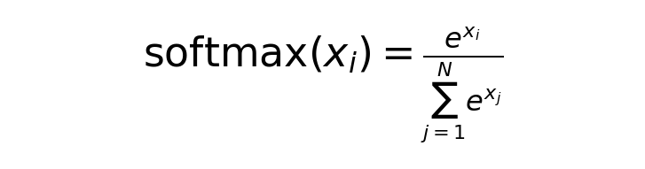

# MLIR Bundle API

## Bundle Container

A SuperDSC Bundle is expressed as a standard MLIR `module` containing a single
`func.func`. The `module` is a top-level container; operations inside it cannot
capture values defined outside. The `func.func` declares the bundle entry point:
it has no return values and its body ends with `return`.

The function MAY declare zero or more parameters. Each parameter is a runtime-provided
value — either a tensor base address or a symbolic dimension size — that the bundle
body uses to compute symbol values passed to `sdscbundle.sdsc_execute`.

**Syntax:**

```mlir
module {
  func.func @sdsc_bundle(%param_0: index,
                         %param_1: !sdscbundle.input_arg<index>) {
    // Bundle operations
    return
  }
}
```

**Operands:**

Each parameter is one of:

| Type | Description |
|---|---|
| *(none)* | No parameters — all symbol values (addresses and sizes) are embedded as `arith.constant` values inside the function body. |
| `index` | A resolved symbol value (base address or dimension size) passed directly as a constant index value. |
| `!sdscbundle.input_arg<index>` | A runtime-provided symbol value (base address or dimension size). MAY carry `granularity=N` and/or `max_value=N` annotations for symbolic dimension parameters. MUST be extracted with `sdscbundle.input_arg_extract` before use. |

**Attributes:**

- **@sdsc_bundle**: Identifier for the callable function region.

**Returns:** None — `func.func` in SDSC Bundles always has no return values.

**Constraints:**

- Exactly one `func.func` per `module`.
- All `sdscbundle.device_mem_allocate` calls MUST appear in the entry block of
  `func.func`, outside any `scf.for` loop.
- Parameters of type `!sdscbundle.input_arg<index>` MUST be extracted with
  `sdscbundle.input_arg_extract` before their value is used in any arithmetic or
  passed to `sdscbundle.sdsc_execute`.

**Example — no parameters (all addresses are compile-time constants):**

```mlir
module {
  func.func @sdsc_bundle() {
    %addr = arith.constant 17179869184 : index
    sdscbundle.sdsc_execute (%addr) {sdsc_filename="sdsc_0.json", symbol_ids=[-1]}
    return
  }
}
```

**Example — one runtime base address:**

```mlir
module {
  func.func @sdsc_bundle(%base_arg: !sdscbundle.input_arg<index>) {
    %base = sdscbundle.input_arg_extract value from %base_arg : !sdscbundle.input_arg<index> -> index
    sdscbundle.sdsc_execute (%base) {sdsc_filename="sdsc_0.json", symbol_ids=[-1]}
    return
  }
}
```

**Example — multiple runtime base addresses:**

```mlir
module {
  func.func @sdsc_bundle(%arg_0: !sdscbundle.input_arg<index>,
                         %arg_1: !sdscbundle.input_arg<index>,
                         %arg_2: !sdscbundle.input_arg<index>) {
    %base_0 = sdscbundle.input_arg_extract value from %arg_0 : !sdscbundle.input_arg<index> -> index
    %base_1 = sdscbundle.input_arg_extract value from %arg_1 : !sdscbundle.input_arg<index> -> index
    %base_2 = sdscbundle.input_arg_extract value from %arg_2 : !sdscbundle.input_arg<index> -> index
    sdscbundle.sdsc_execute (%base_0, %base_1, %base_2) {sdsc_filename="sdsc_0.json", symbol_ids=[-1, -2, -3]}
    return
  }
}
```

---

## Symbolic Values and Addresses

Within a SuperDSC Bundle there are two distinct ways that a value can be
symbolic — that is, not fixed at compile time and resolved by the backend just
before the job is launched. They differ in *what* is unknown and in *where* the
binding information lives in the JSON.

### Symbolic Addresses

A symbolic address is a tensor's **start address in device memory** that is not
a concrete byte offset at compile time. The frontend does not know where the
tensor will be placed — for example, because its location depends on a runtime
allocation or on a per-core layout that is computed by the backend.

On the **JSON side**, a symbolic address is expressed by:
- Setting `isStartAddrSymbolic_: true` on the `allocate` node in
  `scheduleTree_` inside the relevant
  [`ScheduleTreeNode`](../json/scheduletreenode.md).
- Placing symbolic identifier strings (rather than concrete integers) in the
  `data_` entries of `startAddressCoreCorelet_` on that same node.

On the **MLIR side**, the runtime value for each symbolic identifier is
supplied as an operand to `sdscbundle.sdsc_execute`, bound positionally via
`symbol_ids`. That operand can be:
- An `arith.constant` (a fixed address known to the frontend).
- The return value of `sdscbundle.device_mem_allocate` (a backend-allocated
  intermediate buffer address).
- An `index` value extracted from a `!sdscbundle.input_arg<index>` parameter
  via `sdscbundle.input_arg_extract` (a runtime address provided by the caller).
- An affine expression (`affine.apply`) derived from the above.

### Symbolic Dimension Sizes

A symbolic dimension size is a tensor **shape dimension** — such as sequence
length or batch size — that varies at runtime and is therefore not a fixed
integer in the JSON.

On the **JSON side**, symbolic dimension sizes are expressed by:
- [`DesignSpaceConfig.dimToSymbolMapping_`](../json/designspaceconfig.md) — maps
  dimension names (e.g. `"mb_"`, `"in_"`) to symbolic variable names, declaring
  which dimensions are symbolic.
- [`DataStructDims.symbolicDimInfo_`](../json/datastructdims.md) — for each symbolic
  dimension, records `maxSize_` (the upper bound on the dimension size) and
  `granularity_` (the step the runtime value is a multiple of).
- [`DataStructDims.maxSymbolicVolume_`](../json/datastructdims.md) — caps the combined
  volume across a set of symbolic dimensions.
- [`SuperDsc.inputSymbolsAndTags_`](../json/superdsc-object.md) — top-level
  symbol registry at the `SuperDsc` level.

On the **MLIR side**, the runtime value for each symbolic dimension size is
also supplied as an operand to `sdscbundle.sdsc_execute` via `symbol_ids`,
using the same mechanism as symbolic addresses.

### Relationship Between the Two

From the MLIR perspective both kinds of symbolic value are unified: they are
passed as operands to `sdscbundle.sdsc_execute` and bound via `symbol_ids`.
The `symbol_ids` list covers both symbolic start addresses and symbolic
dimension sizes — see the [`sdscbundle.sdsc_execute`](#sdscbundlesdsc_execute)
syntax table above.

The distinction is entirely on the JSON side — the backend routes each symbol
ID to the appropriate field depending on whether it is bound to an
`isStartAddrSymbolic_` allocate node (address) or to a `dimToSymbolMapping_`
entry (size).

One consequence: when a symbolic dimension is **split across cores**, the
per-core start addresses become data-dependent on the runtime dimension value
and MUST therefore also become symbolic. In that case both kinds of symbolic
value appear together in the same JSON file — `symbolicDimInfo_` on the
dimension side and `isStartAddrSymbolic_` on the address side.

---

## sdscbundle Dialect Operations

These operations are defined by the `sdscbundle` dialect and are the primary
means by which a frontend compiler communicates with the Spyre backend.

| Operation | Summary |
|---|---|
| [`sdscbundle.sdsc_execute`](#sdscbundlesdsc_execute) | Instantiates and executes one SDSC JSON operation. |
| [`sdscbundle.device_mem_allocate`](#sdscbundledevice_mem_allocate) | Allocates a contiguous device memory buffer for intermediate or scratch tensors. |
| [`sdscbundle.input_arg_extract`](#sdscbundleinput_arg_extract) | Extracts a named field (`value`, `granularity`, or `max_value`) from a `!sdscbundle.input_arg<index>` bundle parameter. |

**Supporting MLIR operations (permitted use within SDSC Bundles):**

| Operation | Summary |
|---|---|
| [`scf.for`](#scffor) | Loop construct for iterating over a range of SDSC executions. |
| [`arith.constant`](#arithconstant) | Defines a compile-time constant SSA value (e.g. a base address or size). |
| [`arith.addi`](#arithaddi) | Integer addition — used to compute addresses from a base and an offset. |
| [`affine.apply`](#affineapply) | Applies an affine map to compute per-iteration or per-core addresses. |

---

### sdscbundle.sdsc_execute

**Description:**

Instantiates and executes a SuperDSC operation. Each call references one SDSC
JSON file. A single `func.func` body MAY contain one or more `sdsc_execute`
calls in sequence, with each call referencing a different JSON file. This is how
kernel fusion is expressed — multiple operations (e.g., the five steps of a
softmax) are chained as sequential invocations within the same function. Each
invocation optionally substitutes symbolic addresses or sizes with the SSA values
provided as operands.

**Syntax:**

```mlir
sdscbundle.sdsc_execute (%operand1, %operand2, ...) {
  sdsc_filename = "path/to/sdsc.json",
  symbol_ids = [id1, id2, ...]
}
```

**Operands:**

- **%operand1, %operand2, ...** (OPTIONAL): SSA values for symbolic parameters.
  - Type: `index`
  - Order MUST match `symbol_ids` order.
  - Can be constants, affine expressions, loop iterators, or addresses returned
    by `sdscbundle.device_mem_allocate`.
  - Each `sdsc_execute` call has its own independent operand list.

**Attributes:**

- **sdsc_filename** (REQUIRED): `string` — relative path to the SDSC JSON file
  for this invocation; one file per call. Path is relative to the MLIR file
  location.

- **symbol_ids** (OPTIONAL): `array<int>` — list of symbol IDs used in the
  SDSC. Values are negative integers (e.g., `-1`, `-2`, `-3`). Each ID maps
  positionally to one operand and corresponds to a symbolic start address or
  size inside the JSON.

**Returns:** None.

**Constraints:**

- The number of operands MUST equal the length of `symbol_ids`.
- Symbol IDs MUST be unique within a bundle (i.e., the same ID MUST NOT be reused
  across different `sdsc_execute` calls unless both invocations assign the same
  value to that symbol). Inside an `scf.for` loop body, symbol IDs MAY be
  reused across iterations — the loop iterator provides per-iteration
  uniqueness.

**Examples:**

Minimal — single operation, no symbols:

```mlir
sdscbundle.sdsc_execute () {sdsc_filename="sdsc.json"}
```

With a symbolic address:

```mlir
%addr = arith.constant 1024 : index
sdscbundle.sdsc_execute (%addr) {
  sdsc_filename="sdsc.json",
  symbol_ids=[-1]
}
```

With multiple symbolic addresses (one per core):

```mlir
%addr_c0 = arith.constant 1024 : index
%addr_c1 = arith.constant 1152 : index
sdscbundle.sdsc_execute (%addr_c0, %addr_c1) {
  sdsc_filename="sdsc.json",
  symbol_ids=[-1, -2]
}
```

Sequential operations — multiple JSON files in one function (softmax kernel
fusion):



*The softmax function: for each element x_i, divide its exponent by the sum of
exponents of all elements.*

```mlir
module {
  func.func @sdsc_bundle() {
    sdscbundle.sdsc_execute () {sdsc_filename="sdsc_0_max.json"}
    sdscbundle.sdsc_execute () {sdsc_filename="sdsc_1_sub.json"}
    sdscbundle.sdsc_execute () {sdsc_filename="sdsc_2_exp.json"}
    sdscbundle.sdsc_execute () {sdsc_filename="sdsc_3_sum.json"}
    sdscbundle.sdsc_execute () {sdsc_filename="sdsc_4_reciprocal.json"}
    sdscbundle.sdsc_execute () {sdsc_filename="sdsc_5_mul.json"}
    return
  }
}
```

---

### sdscbundle.device_mem_allocate

**Description:**

Allocates a contiguous range of device memory for use within the bundle. This
operation is intended for buffers that are neither kernel inputs nor outputs —
intermediate tensors passed between consecutive SDSCs, and scratch space consumed
internally by a single SDSC. The requested bytes are reserved before the first
SDSC in the bundle executes and held for the entire kernel lifetime; there is no
matching deallocate.

The returned base address is a device byte address in the same address space as
the start addresses used inside `sdsc.json`. It can therefore be passed directly
to `sdscbundle.sdsc_execute` as the value of a symbolic start address, or used
as the base for sub-allocation arithmetic via `arith.addi`.

**Syntax:**

```mlir
%result = sdscbundle.device_mem_allocate <size> bytes : index
```

**Operands:** None.

**Attributes:**

- **size** (REQUIRED): `integer` — size of the requested buffer in bytes. MUST
  be a positive compile-time constant; symbolic sizes are not supported. The
  maximum single request is approximately 15 GB; the underlying segment is 16 GB,
  of which 1 GB is reserved for backend-generated programs and correction tensors.

**Returns:** A single `index` SSA value — the device byte address of the first
byte of the allocated buffer. Contents are undefined at allocation.

**Constraints:**

- MUST appear in the entry block of the bundle function, outside any `scf.for`
  loop. Placing it inside a loop is a correctness trap: the backend reserves one
  buffer for the entire kernel regardless of loop placement, not one per iteration.
- Each call allocates its own non-overlapping range. The total device memory
  required by a bundle is the sum of all its `device_mem_allocate` requests, and
  that sum MUST remain within the ~15 GB budget.
- A frontend that needs to reuse space across tensors with non-overlapping live
  ranges SHOULD issue a single large `device_mem_allocate` and sub-allocate it
  manually using `arith.addi` offsets. When doing so, the frontend MUST ensure
  that sub-ranges whose live ranges overlap are assigned disjoint offset intervals,
  and MUST satisfy the alignment requirement for each sub-range by its choice of
  offset.

**Examples:**

Minimal — allocate a single 64 KB buffer and pass it as a symbolic address:

```mlir
%buf = sdscbundle.device_mem_allocate 65536 bytes : index
sdscbundle.sdsc_execute (%buf) {
  sdsc_filename="op.json",
  symbol_ids=[-1]
}
```

Sub-allocation — carve a 64 KB pool into four 16 KB buffers:

```mlir
%pool = sdscbundle.device_mem_allocate 65536 bytes : index

%off_0     = arith.constant 0     : index
%off_16384 = arith.constant 16384 : index
%off_32768 = arith.constant 32768 : index
%off_49152 = arith.constant 49152 : index

%addr_0     = arith.addi %pool, %off_0     : index
%addr_16384 = arith.addi %pool, %off_16384 : index
%addr_32768 = arith.addi %pool, %off_32768 : index
%addr_49152 = arith.addi %pool, %off_49152 : index

sdscbundle.sdsc_execute (%arg_0, %addr_0)                  {sdsc_filename="sdsc_0.json", symbol_ids=[-1, -2]}
sdscbundle.sdsc_execute (%arg_1, %addr_16384)              {sdsc_filename="sdsc_1.json", symbol_ids=[-3, -4]}
sdscbundle.sdsc_execute (%addr_0, %addr_16384, %addr_32768){sdsc_filename="sdsc_2.json", symbol_ids=[-5, -6, -7]}
sdscbundle.sdsc_execute (%addr_32768, %addr_49152, %arg_2) {sdsc_filename="sdsc_3.json", symbol_ids=[-8, -9, -10]}
```

---

### sdscbundle.input_arg_extract

**Description:**

Extracts a named field from a `!sdscbundle.input_arg<index>` bundle parameter.
The extractable fields are `value`, `granularity`, and `max_value`. Every
`func.func` parameter of type `!sdscbundle.input_arg<index>` MUST be unwrapped
with this operation before its content can be used in arithmetic or passed as an
operand to `sdscbundle.sdsc_execute`.

- `value` — the runtime base address or dimension size provided by the caller.
  Available on all `input_arg` parameters.
- `granularity` — the step constraint for a symbolic dimension size (i.e. the
  runtime value is a multiple of this). Corresponds to `granularity_` in
  [`SymbolicDimInfo`](../json/datastructdims.md#symbolicdiminfo) in the accompanying SDSC.
- `max_value` — the upper bound for a symbolic dimension size. Corresponds to
  `maxSize_` in [`SymbolicDimInfo`](../json/datastructdims.md#symbolicdiminfo) in the
  accompanying SDSC.

**Syntax:**

```mlir
%result = sdscbundle.input_arg_extract value       from %arg : !sdscbundle.input_arg<index> -> index
%result = sdscbundle.input_arg_extract granularity from %arg : !sdscbundle.input_arg<index, granularity=N> -> index
%result = sdscbundle.input_arg_extract max_value   from %arg : !sdscbundle.input_arg<index, max_value=N> -> index
```

**Operands:**

- **%arg** (REQUIRED): An SSA value of type `!sdscbundle.input_arg<index>` (or
  its annotated variant) — MUST be a `func.func` block argument.

**Attributes:** None.

**Returns:** A single `index` SSA value — the extracted field for this argument.

**Constraints:**

- The source operand MUST be a `func.func` block argument of type
  `!sdscbundle.input_arg<index>`; it cannot be the result of another operation.
- MUST appear in the entry block of the bundle function, before any use of the
  extracted value.
- `granularity` and `max_value` MUST NOT be extracted unless the type annotation
  on the parameter declares the corresponding attribute.

**Example — value (base address):**

```mlir
module {
  func.func @sdsc_bundle(%base_arg: !sdscbundle.input_arg<index>) {
    %base = sdscbundle.input_arg_extract value from %base_arg
              : !sdscbundle.input_arg<index> -> index
    sdscbundle.sdsc_execute (%base) {sdsc_filename="sdsc_0.json", symbol_ids=[-1]}
    return
  }
}
```

**Example — granularity and max_value (symbolic dimension):**

```mlir
module {
  func.func @sdsc_bundle(%M_sym: !sdscbundle.input_arg<index, granularity=64, max_value=1024>) {
    %val  = sdscbundle.input_arg_extract value       from %M_sym
              : !sdscbundle.input_arg<index, granularity=64, max_value=1024> -> index
    %gran = sdscbundle.input_arg_extract granularity from %M_sym
              : !sdscbundle.input_arg<index, granularity=64> -> index
    %max  = sdscbundle.input_arg_extract max_value   from %M_sym
              : !sdscbundle.input_arg<index, max_value=1024> -> index
    sdscbundle.sdsc_execute (%val) {sdsc_filename="sdsc_0.json", symbol_ids=[-1]}
    return
  }
}
```

**Example — multiple parameters:**

```mlir
module {
  func.func @sdsc_bundle(%arg_0: !sdscbundle.input_arg<index>,
                         %arg_1: !sdscbundle.input_arg<index>) {
    %base_0 = sdscbundle.input_arg_extract value from %arg_0
                : !sdscbundle.input_arg<index> -> index
    %base_1 = sdscbundle.input_arg_extract value from %arg_1
                : !sdscbundle.input_arg<index> -> index
    sdscbundle.sdsc_execute (%base_0, %base_1) {sdsc_filename="sdsc_0.json", symbol_ids=[-1, -2]}
    return
  }
}
```

---

## Supporting MLIR Operations

The following operations are part of standard upstream MLIR dialects. They are
documented here only in the context of their permitted use within SDSC Bundles.
For full specifications see the [MLIR dialect
documentation](https://mlir.llvm.org/docs/Dialects/).

### scf.for

**Description:**

Loop construct from the Structured Control Flow (SCF) dialect. Used to
iteratively execute one or more SDSC operations, typically to process batches or
to apply address offsets per iteration.

**Syntax:**

```mlir
scf.for %iterator = %lower_bound to %upper_bound step %step {
  // Loop body with SDSC executions
}
```

**Operands:**

- **%lower_bound**: Starting value, inclusive (type: `index`).
- **%upper_bound**: Ending value, exclusive (type: `index`).
- **%step**: Increment per iteration (type: `index`).
- **%iterator**: Loop induction variable (type: `index`) — produced by the op,
  available inside the loop body.

**Attributes:** None — bounds and step are SSA values, not attributes.

**Returns:** None — `scf.for` in SDSC Bundles carries no results.

**Constraints:**

- The lower bound, upper bound, and step of every `scf.for` loop MUST all be
  resolvable to compile-time constants (via constant folding). No symbolic or
  runtime loop bounds are supported in any loop kind, including parametric loops.
- Loop-carried variables are not supported. The induction variable is available
  throughout the loop body and is typically used as an operand to `affine.apply`
  or `arith.addi` to compute per-iteration addresses.
- `sdscbundle.device_mem_allocate` MUST NOT appear inside the loop body. The backend reserves one buffer for the entire kernel regardless of loop placement; placing it inside a loop silently produces one buffer instead of one per iteration.

**Example:**

```mlir
%c0 = arith.constant 0 : index
%c1 = arith.constant 1 : index
%c8 = arith.constant 8 : index

scf.for %i = %c0 to %c8 step %c1 {
  %addr = affine.apply affine_map<(d0) -> (1024 + 128*d0)> (%i)
  sdscbundle.sdsc_execute (%addr) {
    sdsc_filename="sdsc.json",
    symbol_ids=[-1]
  }
}
```

---

### arith.constant

**Description:**

Defines a compile-time constant SSA value. In the SDSC Bundle context this is
primarily used to define base addresses, loop lower bounds, loop upper bounds,
loop step values, and sub-allocation offsets.

**Syntax:**

```mlir
%name = arith.constant <value> : <type>
```

**Operands:** None — the value is encoded as a compile-time attribute.

**Attributes:**

- **value** (REQUIRED): The compile-time constant to be materialised; encoded as
  an integer literal in the source text. Always `index` type in SDSC Bundle
  usage.

**Returns:** A single SSA value of the declared type.

**Constraints:**

- Type MUST be `index` in SDSC Bundle usage.

**Example:**

```mlir
%base_addr   = arith.constant 1024 : index
%lower_bound = arith.constant 0    : index
%upper_bound = arith.constant 8    : index
%step        = arith.constant 1    : index
```

---

### arith.addi

**Description:**

Performs integer addition of two SSA values. In the SDSC Bundle context this is
used to compute memory addresses by adding a constant offset to a base address —
for example, deriving sub-buffer addresses from a pool base returned by
`sdscbundle.device_mem_allocate`.

**Syntax:**

```mlir
%result = arith.addi %lhs, %rhs : <type>
```

**Operands:**

- **%lhs**: Left-hand operand (type: `index`).
- **%rhs**: Right-hand operand (type: `index`).

**Attributes:** None — both operands are SSA values.

**Returns:** A single SSA value of the same type as the operands, containing the
integer sum.

**Constraints:**

- Both operands MUST have the same type (`index` in SDSC Bundle usage).

**Examples:**

Add a fixed offset to a base address:

```mlir
%base   = arith.constant 1024 : index
%offset = arith.constant 256  : index
%addr   = arith.addi %base, %offset : index
```

Derive two per-core sub-buffer addresses from a common pool base:

```mlir
%pool    = sdscbundle.device_mem_allocate 32768 bytes : index
%offset  = arith.constant 16384 : index
%addr_lo = arith.addi %pool, %offset : index   // second half of the pool
```

---

### affine.apply

**Description:**

Applies a compile-time affine map to a set of dimension and symbol operands,
producing a single `index` result. Used in SDSC Bundles to compute per-iteration
or per-core memory addresses from a base address and loop variables.

**Syntax:**

```mlir
%result = affine.apply affine_map<(dims)[symbols] -> (expression)> (dim_values)[symbol_values]
```

Affine maps MAY also be defined as top-level named aliases:

```mlir
#map_name = affine_map<(d0, d1, ...)[s0, s1, ...] -> (expression)>
```

**Operands:**

- **dim_values**: SSA values bound to dimension variables `d0, d1, ...`
  (e.g., loop iterators, core IDs).
- **symbol_values**: SSA values bound to symbol variables `s0, s1, ...`
  (e.g., base addresses — MUST be loop-invariant).

**Attributes:**

- **affine_map** (REQUIRED): A compile-time affine expression. Supported
  operators:
  - Addition: `+`
  - Multiplication: `*`
  - Floor division: `floordiv`
  - Ceiling division: `ceildiv`
  - Modulo: `mod`

**Returns:** A single SSA `index` value — the result of evaluating the affine
expression with the supplied operands.

**Constraints:**

- The affine map MUST be expressible as a linear combination of its dimension
  and symbol variables; non-linear expressions MUST NOT be used.
- Symbol variables MUST be loop-invariant (i.e., defined outside any enclosing
  `scf.for`).

**Examples:**

Single-variable address stride:

```mlir
#stride_map = affine_map<(d0)[base] -> (base + 128*d0)>
%addr = affine.apply #stride_map (%i)[%base_address]
```

Two-variable map combining iteration index and core ID:

```mlir
#addr_map = affine_map<(d0, core)[base] -> (base + 1024*d0 + 256*core)>
%addr = affine.apply #addr_map (%i, %core_id)[%base_address]
```

Concrete evaluation of the above map:

Given:
- `%i = 3` (iteration index)
- `%core_id = 2` (core identifier)
- `%base_address = 0x10000` (65536 in decimal)

```
%addr = 65536 + 1024*3 + 256*2
      = 65536 + 3072 + 512
      = 69120 (0x10E00 in hex)
```

This calculates a memory address by:
1. Starting at base address (65536)
2. Adding iteration offset (1024 bytes per iteration × 3)
3. Adding core-specific offset (256 bytes per core × 2)

## Validation

Bundle `.mlir` files are enforced at two levels:

### 1. Structural constraints — checked by the MLIR verifier

The following are enforced by the `sdscbundle` dialect verifier and the
MLIR parse infrastructure. Violations are reported as parse or verification
errors before the bundle is processed:

- Only operations from the following dialects are permitted:
  `sdscbundle`, `affine`, `arith`, `func`, `scf`. Any other
  dialect is a parse error.
- The number of operands to `sdscbundle.sdsc_execute` MUST equal the
  length of `symbol_ids`.
- `sdscbundle.device_mem_allocate`: `size` MUST be a positive integer.
- `sdscbundle.input_arg_extract`: the source operand MUST be a
  `func.func` block argument of type `!sdscbundle.input_arg<index>`.
  `granularity` and `max_value` MUST NOT be extracted unless those
  annotations are declared on the parameter type.
- `func.func` parameters MUST be of type `index` or
  `!sdscbundle.input_arg<index>`.

### 2. Semantic constraints — checked during pipeline processing

The following are enforced by the backend pipeline after structural
verification passes. Violations result in a backend error during
compilation:

- All `scf.for` bounds (lower, upper, and step) MUST be resolvable to
  compile-time constants. No symbolic or runtime loop bounds are
  supported.
- Symbol IDs MUST be unique across the entire bundle — the same ID
  MUST NOT appear in two different `sdscbundle.sdsc_execute` calls unless
  both supply the same value. Inside an `scf.for` loop body, the same
  symbol IDs MAY be reused across iterations; the loop iterator provides
  per-iteration uniqueness.
- `sdsc_filename` paths MUST resolve relative to the `.mlir` file
  location.

---

[↑ Spec Map](../../SuperDSC-Bundle.md#spec-map)|
