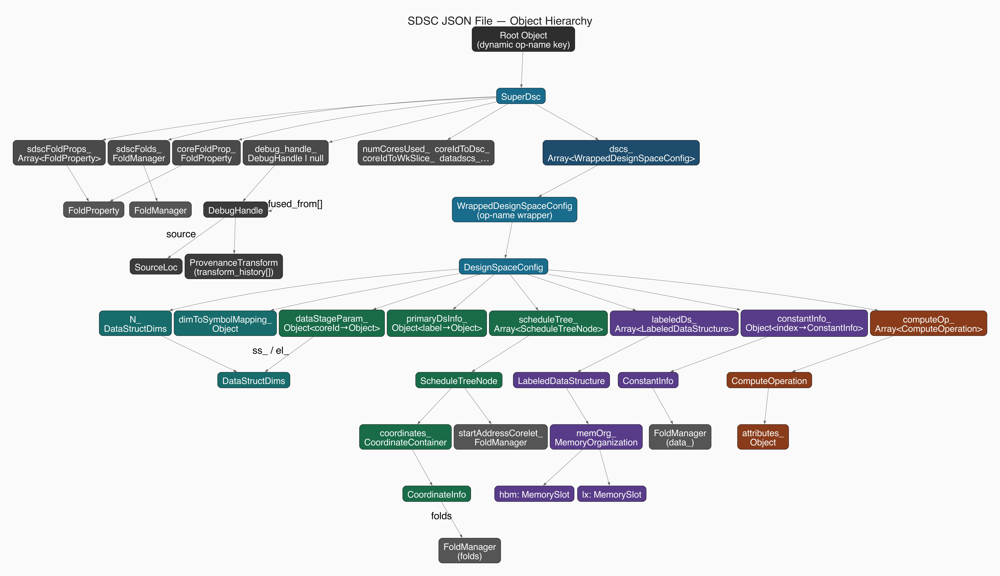

# SDSC JSON API

## Introduction

Each `sdsc_*.json` file in a SuperDSC-Bundle describes a single torch operation to be executed on the Spyre card. One JSON file encodes everything the hardware needs to execute that operation deterministically across one or multiple cores: how the iteration space is divided, how tensors are laid out in memory, where data lives (HBM vs. LX scratchpad), and what compute to perform.

A PyTorch model may translate into several SuperDSC-Bundles. Each bundle is composed of a `bundle.mlir` file (which orchestrates execution flow and symbol management — see [MLIR Bundle API](../dialect/MLIR-bundle-API.md)) and one or more `sdsc_*.json` files.

All `sdsc_*.json` files in a SuperDSC-Bundle MUST conform to [`sdscbundle-schema.json`](../sdscbundle-schema.json), the machine-readable contract written against [JSON Schema draft 2020-12](https://json-schema.org/draft/2020-12).

The schema enforces:

- Required fields and their types at every level of the object hierarchy
- Enum values for `dsType_`, `component_`, `indirectAllocType_`, `indexTensorType_`, `dataFormat_`, `fidelity_`, `nodeType_`, and all other constrained string fields
- Pattern constraints on dynamic keys such as core IDs and operation-name root keys
- Structural rules such as `additionalProperties: false` on all defined objects

For a step-by-step procedural guide to populating these fields, see [Filling a JSON File — Step-by-Step](../../guide/Overview.md#filling-a-json-file--step-by-step) in the Overview guide.

---

## Object Hierarchy & Structural Overview

An SDSC JSON file is structured as a single top-level key (the dynamic operation name) whose value is a **SuperDSC** object. The SuperDSC object defines bundle-level work division, folding, and schedules, and holds a `dscs_[]` array of **DesignSpaceConfig** entries. Each `dscs_[]` entry is a single-key object wrapping a `DesignSpaceConfig` that defines the per-operation tensor descriptors, staging tile sizes, memory allocations, constants, and compute operations.



*Figure: Complete object hierarchy of an SDSC JSON file.*

### Structural Hierarchy Tree

```
Root Object (Dynamic operation name key, e.g. "exp", "matmul", "gelu")
│
└─── SuperDSC (Bundle-level configuration)
     ├─── coreFoldProp_: FoldProperty (required)
     ├─── coreletFoldProp_: FoldProperty (required)
     ├─── numCoresUsed_: integer (required)
     ├─── coreIdToDsc_: Object<coreId → dscIndex> (required)
     ├─── coreIdToDscSchedule: Object<coreId → Array<[datadsc_idx, dldsc_idx, before_sync, after_sync]>> (required)
     ├─── numWkSlicesPerDim_: Object<dimension → sliceCount>
     ├─── coreIdToWkSlice_: Object<coreId → Object<dimension → sliceIndex>>
     ├─── sdscFoldProps_: Array<FoldProperty>
     ├─── sdscFolds_: FoldManager
     ├─── dimToSymbolMappingOpcodeCorrection_: Object<symbol → string>
     ├─── inputSymbolsAndTags_: Object<symbol → string>
     ├─── symbolDefinitions_: Object
     ├─── debug_handle_: DebugHandle | null
     ├─── datadscs_: Array<Object> (always [] when present)
     │
     └─── dscs_: Array<WrappedDesignSpaceConfig> (required)
          │
          └─── WrappedDesignSpaceConfig (operation name wrapper key)
               │
               └─── DesignSpaceConfig (per-operation configuration)
                    ├─── numCoresUsed_: integer (required)
                    ├─── numCoreletsUsed_: integer
                    ├─── coreIdsUsed_: Array<integer> (required)
                    ├─── N_: DataStructDims (required)
                    ├─── dimToSymbolMapping_: Object<dimension → Array<string>>
                    ├─── coordinateMasking_: Object
                    ├─── maskingConstId_: integer
                    ├─── pdsRelation_: Object
                    │
                    ├─── dataStageParam_: Object<stageId → Object>
                    │    ├─── name_: "core" | "corelet" | "row"
                    │    ├─── ss_: DataStructDims
                    │    └─── el_: DataStructDims
                    │
                    ├─── primaryDsInfo_: Object<label → Object>
                    │    ├─── layoutDimOrder_: Array<string>
                    │    ├─── stickDimOrder_: Array<string>
                    │    ├─── stickSize_: Array<integer>
                    │    └─── stickRepl_: Array<integer>
                    │
                    ├─── scheduleTree_: Array<ScheduleTreeNode> (required)
                    │    └─── ScheduleTreeNode
                    │         ├─── nodeType_: "allocate" (required)
                    │         ├─── name_: string (required)
                    │         ├─── ldsIdx_: integer
                    │         ├─── component_: "hbm" | "lx"
                    │         ├─── layoutDimOrder_: Array<string>
                    │         ├─── maxDimSizes_: Array<integer>
                    │         ├─── isStartAddrSymbolic_: boolean | 0 | 1
                    │         ├─── startAddressCoreCorelet_: FoldManager
                    │         ├─── backGapCore_: Object
                    │         ├─── padding_: Object
                    │         ├─── indirectAllocType_: "no_indirection" | "value_tensor" | "index_tensor"
                    │         ├─── relatedIndirectAccessAlloc_: string
                    │         ├─── indexTensorType_: "index" | "address"
                    │         └─── coordinates_: CoordinateContainer
                    │              └─── coordInfo: Object<dimension → CoordinateInfo>
                    │                   └─── folds: FoldManager (required)
                    │
                    ├─── labeledDs_: Array<LabeledDataStructure> (required)
                    │    └─── LabeledDataStructure
                    │         ├─── ldsIdx_: integer (required)
                    │         ├─── dsName_: string (required)
                    │         ├─── dsType_: "INPUT" | "OUTPUT" | "KERNEL" | "KERNEL_IDX" (required)
                    │         ├─── scale_: Array<number>
                    │         ├─── wordLength: number (>0; fractional for sub-byte types)
                    │         ├─── dataFormat_: string (required)
                    │         └─── memOrg_: MemoryOrganization (required)
                    │              ├─── hbm: MemorySlot (isPresent, isPadded, isZeroPadded, allocateNode_)
                    │              └─── lx: MemorySlot (isPresent, isPadded, isZeroPadded, allocateNode_)
                    │
                    ├─── constantInfo_: Object<index → ConstantInfo> | string "{}"
                    │    └─── ConstantInfo
                    │         ├─── name_: string (required)
                    │         ├─── dataFormat_: string (required)
                    │         └─── data_: FoldManager (required)
                    │
                    └─── computeOp_: Array<ComputeOperation> (required)
                         └─── ComputeOperation
                              ├─── exUnit: "sfp" | "pt" (required)
                              ├─── opFuncName: string (required)
                              ├─── attributes_: Object (dataFormat_, fidelity_)
                              ├─── inputLabeledDs: Array<string> (required)
                              ├─── outputLabeledDs: Array<string> (required)
                              └─── indirectAccessIndexLabeledDs: Array<string>
```

---

## JSON Object Reference Index

Below is the complete index of all 16 specification documents governing the SDSC JSON format, organized by architectural layer.

### 1. Bundle & Top-Level Objects

| Object / Topic | Document | Description |
|---|---|---|
| **SuperDSC** | [superdsc-object.md](superdsc-object.md) | Top-level object holding core folds, work-slice mappings, per-core schedule tuples, and the `dscs_[]` array. |
| **FoldProperty** | [foldproperty.md](foldproperty.md) | Pairs a fold factor with a memory hierarchy level label (`"core"`, `"corelet"`, `"time"`, etc.) for compact multi-core representations. |
| **FoldManager** | [foldmanager.md](foldmanager.md) | Reusable structure mapping multi-dimensional loop index tuples (core, corelet, time) to coordinates and start addresses via affine functions. |

### 2. Design Space Configuration & Staging

| Object / Topic | Document | Description |
|---|---|---|
| **DesignSpaceConfig** | [designspaceconfig.md](designspaceconfig.md) | Per-operation configuration container holding tensor descriptors, staging parameters, memory schedule tree, constants, and compute operations. |
| **DataStructDims** | [datastructdims.md](datastructdims.md) | Dimension-size specification for total problem dimensions (`N_`), per-core tile staging (`ss_`, `el_`), and symbolic dimension metadata. |
| **DataStageParam** | [datastageparam.md](datastageparam.md) | Per-core tile sizes for steady-state (`ss_`) and epilogue (`el_`) passes transferring data into LX scratchpad memory. |
| **PrimaryDsInfo** | [primarydsinfo.md](primarydsinfo.md) | Tensor role layout descriptor defining memory dimension ordering and stick packing configuration. |

### 3. Memory Scheduling & Coordinates

| Object / Topic | Document | Description |
|---|---|---|
| **ScheduleTreeNode** | [scheduletreenode.md](scheduletreenode.md) | Allocation node specifying device memory placement (HBM or LX), dimension order, per-core start addresses, and coordinate mapping. |
| **CoordinateContainer** | [coordinatecontainer.md](coordinatecontainer.md) | Container holding the per-dimension `CoordinateInfo` dictionary for tensor coordinates. |
| **CoordinateInfo** | [coordinateinfo.md](coordinateinfo.md) | Spatial/temporal partitioning flags, padding classification, and affine `FoldManager` mappings per tensor dimension. |

### 4. Tensor Descriptors & Constants

| Object / Topic | Document | Description |
|---|---|---|
| **LabeledDataStructure** | [labeleddatastructure.md](labeleddatastructure.md) | Logical tensor descriptor defining role (`INPUT`, `OUTPUT`, `KERNEL`), data format, bit width, broadcast scale, and memory residency. |
| **MemoryOrganization** | [memoryorganization.md](memoryorganization.md) | Hardware residency flags and allocate-node links for HBM and LX scratchpad memory slots. |
| **ConstantInfo** | [constantinfo.md](constantinfo.md) | Constant tensors and scalar values encoded via affine `FoldManager` structures. |

### 5. Compute Operations

| Object / Topic | Document | Description |
|---|---|---|
| **ComputeOperation** | [computeoperation.md](computeoperation.md) | Compute kernel specification defining execution engine (`pt` or `sfp`), operation name, numeric fidelity, and input/output tensor bindings. |

### 6. Layout & Padding Constraints

| Object / Topic | Document | Description |
|---|---|---|
| **Stick Layout Constraints** | [stick-layout-constraints.md](stick-layout-constraints.md) | Normative hardware stick constraints per operation category and per-core work-division rules. |
| **Padding** | [padding.md](padding.md) | Convolution and pooling window padding specification across steady-state and epilogue tiles. |
| **Stick-Alignment Padding** | [stick-padding.md](stick-padding.md) | Hardware stick-dimension alignment and padding requirements across memory components. |

---

## Section-by-Section Structural Specification

### 1. Root Key and Bundle-Level Structure (`SuperDsc`)
The root of the document is a single-key dictionary where the key is the operation name string (e.g., `"matmul"`, `"conv2d"`), matching regex `^[a-zA-Z0-9_/\-][a-zA-Z0-9_/\-]*$`. Its value is the [`SuperDsc`](superdsc-object.md) object.
- **Fold hierarchy**: `coreFoldProp_` specifies the core-level division factor (up to 32); `coreletFoldProp_` is emitted with factor 1 as a pass-through constant.
- **Work division**: `numWkSlicesPerDim_` and `coreIdToWkSlice_` map loop dimensions (e.g. `mb`, `out`) across individual cores.
- **Scheduling**: `coreIdToDsc_` maps each string core ID (`"0"`, `"1"`, …) to a zero-based index in `dscs_`. `coreIdToDscSchedule` assigns a 4-integer step tuple `[datadsc_idx, dldsc_idx, before_sync, after_sync]` per core.
- **Symbolic registry**: Optional fields (`symbolDefinitions_`, `inputSymbolsAndTags_`, `dimToSymbolMappingOpcodeCorrection_`) register dynamic runtime symbols.

### 2. Wrapped DSC (`WrappedDesignSpaceConfig`)
The `dscs_` array contains one or more `WrappedDesignSpaceConfig` entries. Each entry is a single-key object whose key is the sub-operation name and whose value is the [`DesignSpaceConfig`](designspaceconfig.md).
- **Core allocation**: `numCoresUsed_` and `coreIdsUsed_` record the active cores for this compute phase.
- **Global problem geometry**: `N_` ([`DataStructDims`](datastructdims.md)) holds the un-tiled problem dimensions. Inactive dimensions are set to `-1`. Symbolic dimensions are set to `-1` and referenced in `dimToSymbolMapping_`.

### 3. Data Staging (`dataStageParam_`)
Holds tile staging configurations keyed by string index (`"0"`):
- `ss_`: Steady-state tile size per core for full iterations.
- `el_`: Epilogue tile size per core for boundary iterations.
- `paddingSizes_`: Optional window padding parameters for convolution/pooling operations.

### 4. Tensor Layout (`primaryDsInfo_`)
Maps tensor roles (`INPUT`, `OUTPUT`, `KERNEL`, `KERNEL_IDX`) to layout descriptors:
- `layoutDimOrder_`: Memory dimension order (outermost to innermost).
- `stickDimOrder_` & `stickSize_`: Parallel arrays defining stick composition and hardware packing according to [Stick Layout Constraints](stick-layout-constraints.md).

### 5. Memory Allocation Schedule (`scheduleTree_`)
An ordered array of [`ScheduleTreeNode`](scheduletreenode.md) objects representing allocation nodes (`nodeType_: "allocate"`):
- `component_`: Memory level (`"hbm"` or `"lx"`).
- `startAddressCoreCorelet_`: A [`FoldManager`](foldmanager.md) mapping each core to its byte offset (or symbol ID if `isStartAddrSymbolic_` is `true`).
- `coordinates_`: A [`CoordinateContainer`](coordinatecontainer.md) containing a [`CoordinateInfo`](coordinateinfo.md) for each tensor dimension with affine fold expressions mapping the core/corelet/row index to tensor coordinates.

### 6. Tensor Descriptors (`labeledDs_`)
An array of [`LabeledDataStructure`](labeleddatastructure.md) entries describing each logical tensor:
- `ldsIdx_`: Sequential zero-based integer index.
- `dsType_`: Role matching `primaryDsInfo_` (`"INPUT"`, `"OUTPUT"`, `"KERNEL"`, `"KERNEL_IDX"`).
- `dataFormat_`: Hardware data type (e.g. `"SEN169_FP16"`, `"IEEE_FP32"`).
- `scale_`: Per-dimension broadcast/reduction scale vector (`1` = normal, `-1` = contracted/reduced).
- `memOrg_`: [`MemoryOrganization`](memoryorganization.md) object indicating presence in `hbm` and/or `lx` scratchpads.

### 7. Constants (`constantInfo_`)
A map of string-integer indices (`"0"`, `"1"`, …) to [`ConstantInfo`](constantinfo.md) objects encoding constant values and broadcast addresses via a `FoldManager`. When no constants are used, the producer emits the string `"{}"`.

### 8. Compute Operations (`computeOp_`)
An array of [`ComputeOperation`](computeoperation.md) entries specifying execution kernels:
- `exUnit`: Target execution engine (`"pt"` for Processing Tree / matrix engine, `"sfp"` for Streaming Floating-Point vector engine).
- `opFuncName`: Target hardware kernel name (e.g. `"batchmatmul"`, `"gelufwd"`, `"conv2dfwd"`).
- `attributes_`: Execution parameters including numeric `dataFormat_` and `fidelity_` (`"regular"` or `"fast"`).
- `inputLabeledDs` & `outputLabeledDs`: Named tensor references formatted as `"<dsName_>-idx<ldsIdx_>"`.

---

## Producer Conventions & Invariants

Any frontend producer emitting SDSC JSON (such as `torch-spyre`) MUST adhere to the following structural conventions:

1. **Root Key & Wrapper Key Pattern**: The top-level root key and the `dscs_` wrapper keys MUST match `^[a-zA-Z0-9_/\-][a-zA-Z0-9_/\-]*$`.
2. **String-Integer Map Keys vs. Integer Arrays**: In map structures (such as `coreIdToDsc_`, `coreIdToWkSlice_`, `coreIdToDscSchedule`, `constantInfo_`, `dataStageParam_`), core IDs and sequence indices MUST be string-encoded integers (e.g. `"0"`, `"1"`). In array structures (such as `coreIdsUsed_`), core IDs MUST be literal integers (`0`, `1`).
3. **Sentinel Values (`-1`)**: Inactive dimension fields in `N_`, unset staging dimensions, unbound dimensions in `maxDimSizes_`, and the default `datadsc_idx` in `coreIdToDscSchedule` all use `-1` as the sentinel value.
4. **Empty Structures**:
   - `constantInfo_` uses the string `"{}"` when no constants are present.
   - `datadscs_` MUST be an empty array `[]` when emitted by the frontend.
   - `coreletSplit_` in staging parameters is emitted as `{}`.
5. **Pass-Through Constants**: Because `torch-spyre` partitions work at the core level and leaves corelet splitting to DeepTools, frontend-emitted artifacts set `coreletFoldProp_` to `{"factor_": 1, "label_": "corelet"}` and `numCoreletsUsed_` to `1`.
6. **Schedule Step Tuple**: Each core schedule entry in `coreIdToDscSchedule` MUST be an array of exactly 4 integers `[datadsc_idx, dldsc_idx, before_sync, after_sync]`. Common single-DSC default is `[-1, 0, 0, 0]`.
7. **Strict Schema Conformance**: All objects have `additionalProperties: false`. No extra or undeclared fields may be included.

---

[↑ Spec Map](../../SuperDSC-Bundle.md#spec-map)|
